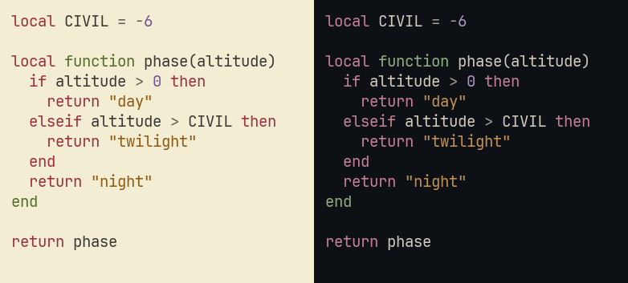
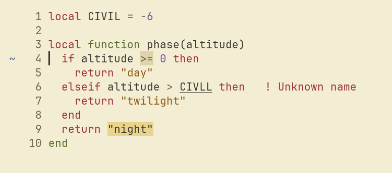
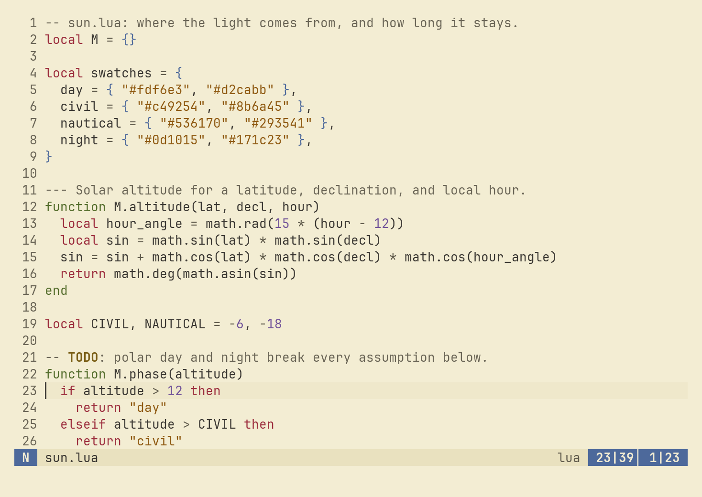
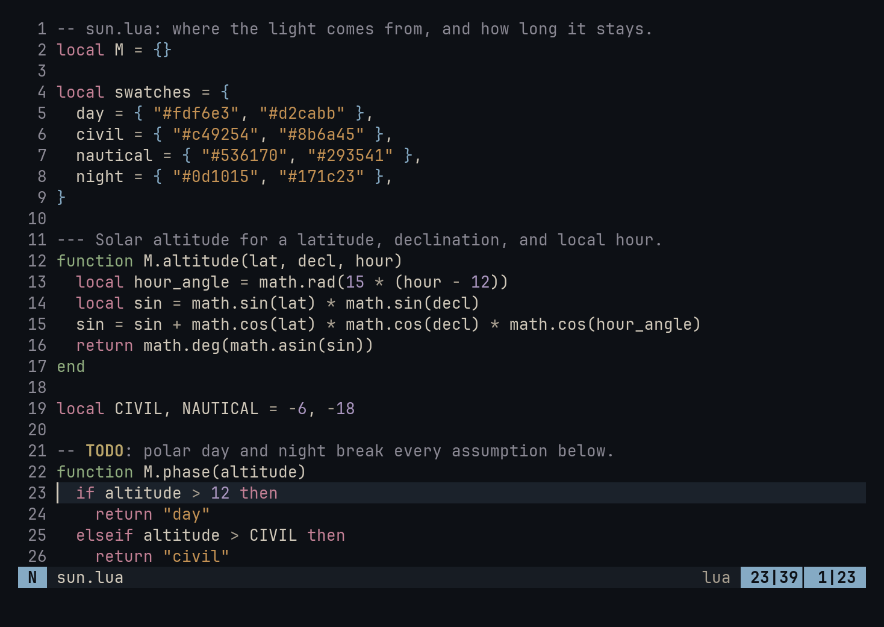
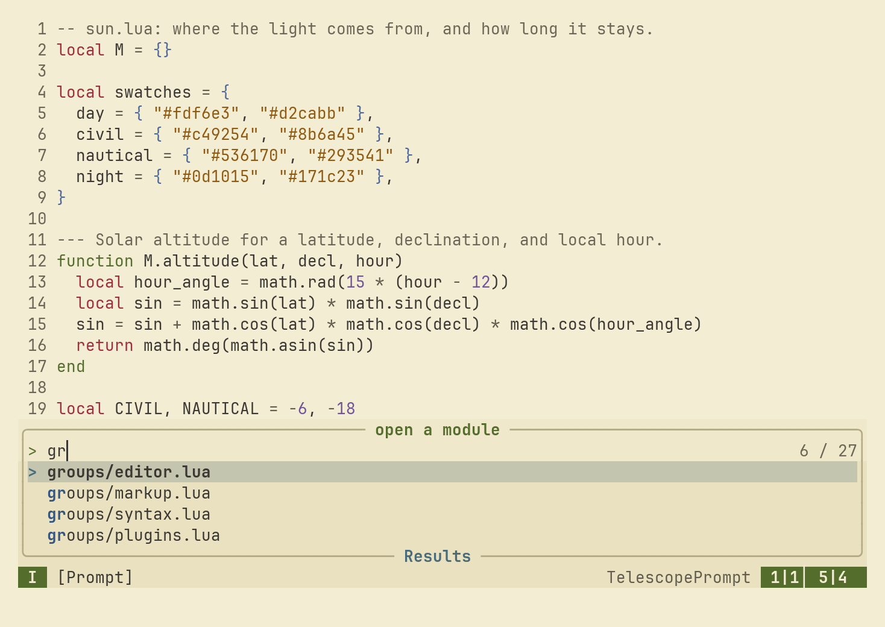
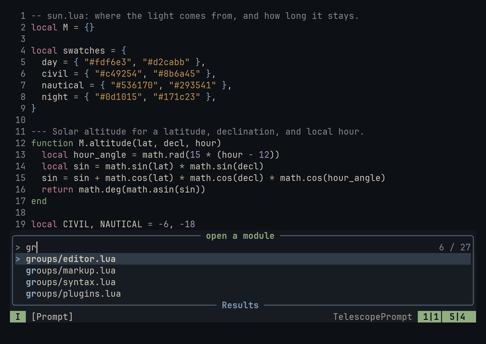

# Sundial

Two Neovim themes inspired by the light you work in. **Last Light** puts warm
ivory and amber on a near-black canvas. **First Light**, its light counterpart,
pairs warm paper with daylight inks, after light Gruvbox and Kanagawa Lotus.

Requires Neovim 0.10 or newer. No runtime dependencies.

## Screenshots

**First Light** (left) and **Last Light** (right), on the same Lua function:



**First Light while editing:** the gutter `~` and tinted `>=` mark a changed
condition, the inline `!` flags `CIVLL`, and search highlights `"night"`.



<details>
<summary>Full-size editor and Telescope screenshots</summary>




Telescope, in the bottom third so the buffer stays readable:




</details>

## Installation

With lazy.nvim:

```lua
{
  "IGeraGera/sundial.nvim",
  lazy = false,
  priority = 1000,
  config = function()
    vim.cmd.colorscheme("last-light")
  end,
}
```

With `vim.pack`:

```lua
vim.pack.add({ "https://github.com/IGeraGera/sundial.nvim" })
vim.cmd.colorscheme("last-light")
```

Use `:colorscheme first-light` for the light palette. Both schemes work without
calling `setup()`. Call `require("sundial").setup({ ... })` before loading
one if you want to customize it.

```lua
require("sundial").setup({
  -- Let the terminal background show through.
  transparent = false,
  -- Write the 16 ANSI colors used by :terminal.
  terminal_colors = true,
  -- Per-role styles: comments, keywords, functions, variables.
  styles = { comments = { italic = true } },
  -- Change palette values before terminal colors and highlights are built.
  on_colors = function(colors)
    colors.amber = "#C49254"
  end,
  -- Override final groups with a highlight table or a link string.
  on_highlights = function(groups)
    groups.OilDir = "Directory"
  end,
})
```

`on_colors` runs before terminal colors and highlights are built.
`on_highlights` receives the final groups and the palette. Groups can be
highlight tables or links specified as strings.

## Plugin support

<details>
<summary>Included plugins</summary>

- Blink
- Oil
- Org
- render-markdown
- GitSigns
- Telescope
- mini.statusline
- which-key

Highlights for these plugins are defined without loading them, plus small
Tree-sitter extensions for Markdown table labels and unquoted YAML keys.

</details>

## Extras

Kitty and VS Code / Hermes themes live in `extras/`. See
[extras/kitty/README.md](extras/kitty/README.md) and
[extras/vscode/README.md](extras/vscode/README.md) for install instructions.
[AGENTS.md](AGENTS.md) explains how to regenerate them after palette changes.
